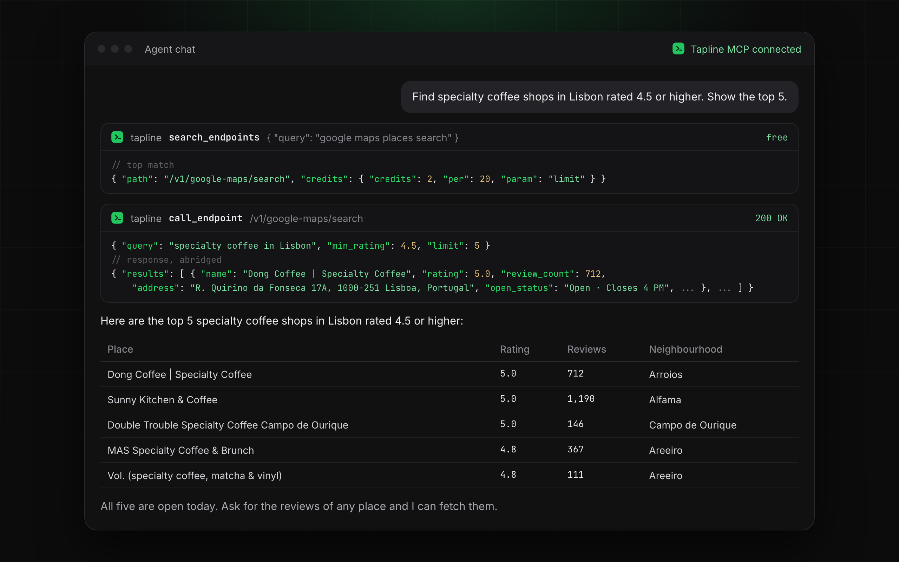
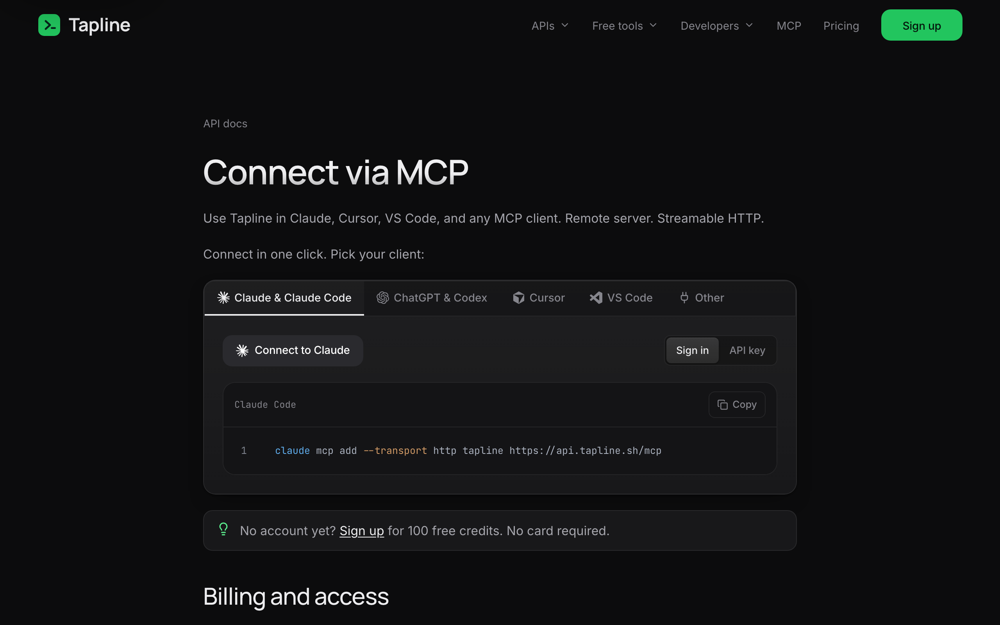

<p align="center">
  <picture>
    <source media="(prefers-color-scheme: dark)" srcset="assets/tapline-wordmark-on-dark.svg">
    
  </picture>
</p>

<p align="center">
  <b>Structured web data for your AI agent.</b><br>
  A remote MCP server. Live JSON from YouTube, TikTok, Instagram, LinkedIn, Airbnb, Zillow, Google Maps and more.
</p>

<p align="center">
  <a href="https://registry.modelcontextprotocol.io/v0/servers?search=sh.tapline/tapline"></a>
  <a href="https://glama.ai/mcp/connectors/sh.tapline/tapline"></a>
  <a href="https://mcptry.com/servers/sh.tapline/tapline"></a>
</p>

<p align="center">
  <a href="https://cursor.com/install-mcp?name=tapline&config=eyJ1cmwiOiJodHRwczovL2FwaS50YXBsaW5lLnNoL21jcCJ9"></a>
  <a href="https://vscode.dev/redirect/mcp/install?name=tapline&config=%7B%22type%22%3A%22http%22%2C%22url%22%3A%22https%3A%2F%2Fapi.tapline.sh%2Fmcp%22%7D"></a>
  <a href="https://claude.ai/customize/connectors?modal=add-custom-connector&connectorName=Tapline&connectorUrl=https%3A%2F%2Fapi.tapline.sh%2Fmcp"></a>
</p>

<p align="center">
  <a href="https://tapline.sh">Website</a> ·
  <a href="https://tapline.sh/docs/mcp">MCP docs</a> ·
  <a href="https://tapline.sh/docs">API reference</a> ·
  <a href="https://x.com/taplinescraping">X</a>
</p>



# Tapline MCP Server

Tapline gives AI agents live, structured data from public web pages. You connect one remote MCP server. Your agent finds the right endpoint, reads its parameters and fetches the data as JSON.

- **Endpoint:** `https://api.tapline.sh/mcp` (Streamable HTTP)
- **Auth:** OAuth 2.1 with Dynamic Client Registration (sign in with a Tapline account), or an API key as `Authorization: Bearer`
- **Registry name:** `sh.tapline/tapline`
- **Free start:** 100 free credits. No card required.

> **About this repository.** This repository holds docs, client configs, brand assets and the registry [`server.json`](server.json). It holds no server source code. Tapline is a proprietary hosted service. The server runs at `https://api.tapline.sh/mcp`. There is nothing to install or run.

## Contents

- [Features](#features)
- [Supported sources](#supported-sources)
- [Tools](#tools)
- [Installation](#installation)
- [Authentication](#authentication)
- [Example prompts](#example-prompts)
- [Pricing and credits](#pricing-and-credits)
- [FAQ](#faq)
- [Support](#support)
- [Links](#links)
- [License](#license)

## Features

- **One server, many sources.** 16 sources through one MCP server: social, property, travel, search and jobs.
- **Structured JSON.** Every endpoint returns documented fields with fixed types. Empty fields and duplicate media sizes are left out of MCP results.
- **Find before you spend.** `search_endpoints` and `get_endpoint` are free. They show the path, parameters and credit cost before your agent calls anything.
- **Read-only.** All four tools only read public data. No tool posts, edits or deletes.
- **Long results in pages.** A result that is too long is cut. `read_more` returns the rest for free for 30 minutes.
- **No charge for failures.** A request that is blocked, times out or fails inside Tapline costs 0 credits.
- **Remote and hosted.** Nothing to install or run. Add the URL and sign in.
- **Same account as the REST API.** One credit pool for MCP, the REST API and the Python, TypeScript and CLI clients.

## Supported sources

| Source | Data |
| --- | --- |
| YouTube | Transcripts, video metadata, comments and replies, search, channels, channel videos, playlists, formats, heatmaps |
| TikTok | Profiles, videos, transcripts, comments, followers, sounds, search results, trends |
| Instagram | Profiles, posts, reels, comments, highlights, topic search |
| X (Twitter) | Profiles, recent posts, single posts, Communities |
| LinkedIn | Profiles, company pages, posts, post transcripts, job search, job listings |
| Facebook | Public pages, posts, photos, videos, comments, groups, events |
| Facebook Ad Library | Ads, ad versions, advertisers, audiences, political ad reports |
| Facebook Marketplace | Search, category listings, full listings with photos, rentals |
| Pinterest | Pin search, pin details, board pins, user boards |
| Airbnb | Location search, listing search, listing details, prices, availability calendar, reviews |
| Zillow | Home search, property details, price history, sale and tax records, comparables, location suggestions |
| imovelweb | Brazilian property listings, map results, property details, agency contact data |
| Expedia | Hotel search, rooms and rates, price calendars, guest reviews, things to do, flight search, fare calendar |
| Google Maps | Place search, places, reviews, photos, posts, directions, popular times, Street View |
| Brave Search | Web, news, video, image and place search, AI answers, directions, sports |
| Indeed | Job search, full job postings, company profiles and ratings, company jobs, reported pay |

The public OpenAPI document lists every endpoint: https://api.tapline.sh/openapi.json

## Tools

All tools are read-only (`readOnlyHint: true`, `destructiveHint: false`).

| Tool | Use | Cost |
| --- | --- | --- |
| `search_endpoints` | Find endpoints by keyword. Returns up to 15 matches with path, summary and credit cost. | Free |
| `get_endpoint` | Show one endpoint's parameters, request body schema and credit cost. | Free |
| `call_endpoint` | Fetch data from one endpoint. Returns the status, the credits charged and the JSON response. | Credits that `search_endpoints` shows |
| `read_more` | Return the next items of a cut `call_endpoint` result. Works for 30 minutes. Sends no new request. | Free |

### `search_endpoints`

| Parameter | Type | Required | Description |
| --- | --- | --- | --- |
| `query` | string | yes | Keywords, for example `airbnb reviews` or `tiktok user videos`. |

### `get_endpoint`

| Parameter | Type | Required | Description |
| --- | --- | --- | --- |
| `path` | string | yes | Path from `search_endpoints`. |

### `call_endpoint`

A response too long for one result is cut: `shortened` names each cut and `continuation` holds the id for `read_more`.

| Parameter | Type | Required | Description |
| --- | --- | --- | --- |
| `path` | string | yes | Endpoint path with any `{placeholders}` filled in. |
| `query` | object | no | Query parameters. A list value repeats the parameter. |
| `body` | object | no | JSON request body, for endpoints that `get_endpoint` shows a request body schema for. |

### `read_more`

| Parameter | Type | Required | Description |
| --- | --- | --- | --- |
| `continuation` | string | yes | The `continuation.id` of a cut `call_endpoint` or `read_more` result. |

### How an agent uses the tools

1. `search_endpoints` with `google maps places search` returns `/v1/google-maps/search` at 2 credits per 20 results.
2. `get_endpoint` with that path shows the parameters: `query`, `min_rating`, `open_now`, `limit` and more.
3. `call_endpoint` with `{"query": "specialty coffee in Lisbon", "min_rating": 4.5, "limit": 5}` returns the places as JSON.
4. If the result is cut, `read_more` returns the rest.

## Installation

Server URL for every client: `https://api.tapline.sh/mcp`

Ready-to-copy files for each client are in [`configs/`](configs/). Each client has an OAuth file and an API key file.



### Claude (claude.ai and Claude Desktop)

[Open this link](https://claude.ai/customize/connectors?modal=add-custom-connector&connectorName=Tapline&connectorUrl=https%3A%2F%2Fapi.tapline.sh%2Fmcp) and sign in.

Or add a custom connector by hand. Name: `Tapline`. URL: `https://api.tapline.sh/mcp`. Then sign in.

On Team and Enterprise plans, an Owner adds the connector once. Each member signs in with their own Tapline account. Owners can set the tools to "Always allow" in the organization connector settings.

### Claude Code

```bash
claude mcp add --transport http tapline https://api.tapline.sh/mcp
```

With an API key:

```bash
claude mcp add --transport http tapline https://api.tapline.sh/mcp \
  --header "Authorization: Bearer $TAPLINE_API_KEY"
```

Project-scoped `.mcp.json`: [`configs/claude-code.mcp.json`](configs/claude-code.mcp.json), or [`configs/claude-code-api-key.mcp.json`](configs/claude-code-api-key.mcp.json) with an API key.

### ChatGPT

Go to chatgpt.com/plugins, select **+**, then **Add custom MCP server**. Enter `https://api.tapline.sh/mcp`, choose OAuth and sign in.

### Codex

```bash
codex mcp add tapline --url https://api.tapline.sh/mcp
codex mcp login tapline
```

With an API key:

```bash
codex mcp add tapline --url https://api.tapline.sh/mcp \
  --bearer-token-env-var TAPLINE_API_KEY
```

`~/.codex/config.toml`: [`configs/codex.toml`](configs/codex.toml), or [`configs/codex-api-key.toml`](configs/codex-api-key.toml) with an API key.

### Cursor

[One-click install](https://cursor.com/install-mcp?name=tapline&config=eyJ1cmwiOiJodHRwczovL2FwaS50YXBsaW5lLnNoL21jcCJ9), or paste this into `~/.cursor/mcp.json` and sign in:

```json
{
  "mcpServers": {
    "tapline": {
      "url": "https://api.tapline.sh/mcp"
    }
  }
}
```

With an API key: [`configs/cursor-api-key.json`](configs/cursor-api-key.json).

### VS Code

[One-click install](https://vscode.dev/redirect/mcp/install?name=tapline&config=%7B%22type%22%3A%22http%22%2C%22url%22%3A%22https%3A%2F%2Fapi.tapline.sh%2Fmcp%22%7D), or paste this into `.vscode/mcp.json` and sign in:

```json
{
  "servers": {
    "tapline": {
      "type": "http",
      "url": "https://api.tapline.sh/mcp"
    }
  }
}
```

With an API key: [`configs/vscode-api-key.json`](configs/vscode-api-key.json). VS Code asks for the key once and stores it securely.

### Other MCP clients

Add the server URL `https://api.tapline.sh/mcp` with the Streamable HTTP transport. Sign in with OAuth, or send the header `Authorization: Bearer YOUR_API_KEY`.

Discovery document: https://tapline.sh/.well-known/mcp.json

## Authentication

**OAuth (recommended).** Clients that support MCP OAuth open a browser window. You sign in with your Tapline account. The server uses OAuth 2.1 with Dynamic Client Registration. Protected resource metadata: `https://api.tapline.sh/.well-known/oauth-protected-resource/mcp`.

When you sign in, Tapline creates an API key named "MCP connector" in your account. Calls are billed to that key. To cut access, revoke the key in the dashboard under API keys.

**API key.** Create a key at https://tapline.sh/dashboard?tab=api-keys. Send it as `Authorization: Bearer sk_live_...`. Keep the key in an environment variable such as `TAPLINE_API_KEY`. Do not commit it.

## Example prompts

- Get the transcript of this YouTube video and summarise it in 5 points: `<url>`
- Find Airbnb listings in Lisbon for next weekend for 2 adults. List the 5 cheapest with their rating.
- Summarise the latest posts of this Instagram profile: `<handle>`
- Find specialty coffee shops in Lisbon rated 4.5 or higher. Show the top 5.
- Get the Google Maps reviews of `<place>` and group the complaints by topic.
- Show the price history, tax records and comparable homes for this Zillow property: `<url>`
- Get the LinkedIn company page of `<company>` and its latest posts.
- Search LinkedIn jobs for "data engineer" in Berlin and list the companies that are hiring.
- Which ads does `<brand>` run in the Facebook Ad Library right now?
- Get the transcript of this TikTok video and list the products it mentions: `<url>`
- Find hotels in Paris on Expedia for next weekend. Compare price and guest rating.
- Search Indeed for remote product manager jobs in the US and show the reported pay.

## Pricing and credits

MCP calls use the same credits, prices and rate limits as the REST API. One credit pool covers every source.

| Plan | Price | Credits | Rate limit |
| --- | --- | --- | --- |
| Free | $0, no card | 100 on sign-up | 1 request/s |
| Pay as you go | From $9 (one-time) | 5,000 to 175,000 per pack. Credits never expire. | 5 requests/s |
| Starter | $49/month, or $468/year | 100,000/month | 5 requests/s |
| Growth | $199/month, or $1,908/year | 1,000,000/month | 25 requests/s |
| Pro | $499/month, or $4,788/year | 4,000,000/month | 50 requests/s |
| Enterprise | Custom | More than 4,000,000/month | Higher limits |

Credit packs: 5,000 credits for $9, 25,000 for $35, 75,000 for $90, 175,000 for $175.

Each endpoint costs 1 to 10 credits per call. `search_endpoints` shows the cost before you call. Examples:

| Endpoint | Credits |
| --- | --- |
| YouTube transcript | 2 |
| TikTok transcript | 1 |
| X (Twitter) profile | 1 |
| Instagram profile | 3 |
| LinkedIn profile | 2 |
| Google Maps search | 2 per 20 results |
| Google Maps reviews | 2 |
| Zillow property | 2 |
| Airbnb listing details | 5 |

Failed requests cost 0 credits: blocked by the target, timed out, or an internal error. A response that shows the resource does not exist costs 0 credits (YouTube is the exception: it charges for this response). `search_endpoints`, `get_endpoint` and `read_more` are free.

Current prices: https://tapline.sh/#pricing

## FAQ

**Is there a free plan?**
Yes. New accounts get 100 free credits. No card is required.

**Which MCP clients work?**
Any client that supports remote servers over Streamable HTTP. Setup steps exist for Claude, Claude Code, ChatGPT, Codex, Cursor and VS Code.

**Do I need an API key?**
No. Clients that support MCP OAuth sign in through the browser. Use an API key for clients without OAuth, or for scripts and CI.

**Can the tools change anything?**
No. All four tools are read-only. They read public web data and your Tapline endpoint catalog.

**What happens when a result is too long?**
The result is cut. The response names each cut list and gives a `continuation` id. `read_more` returns the next items for free for 30 minutes.

**Do failed requests cost credits?**
No. Requests that are blocked, time out or fail inside Tapline cost 0 credits.

**Can I self-host the server?**
No. Tapline is a proprietary hosted service. This repository has docs and configs only. The Python, TypeScript and CLI clients are open source (MIT) on GitHub.

**Can I use the same data without MCP?**
Yes. The same endpoints are a REST API with an `X-API-Key` header. See https://tapline.sh/docs.

**How do I stop access for one client?**
Revoke its "MCP connector" key in the dashboard under API keys.

## Support

- Bugs and endpoint requests: [open an issue](https://github.com/TaplineData/tapline-mcp/issues/new/choose).
- Account and billing: hello@tapline.sh
- Security reports: see [SECURITY.md](SECURITY.md).

## Links

- Website: https://tapline.sh
- MCP docs: https://tapline.sh/docs/mcp
- API reference: https://tapline.sh/docs
- OpenAPI: https://api.tapline.sh/openapi.json
- MCP discovery: https://tapline.sh/.well-known/mcp.json
- Official MCP Registry: `sh.tapline/tapline`
- Glama: https://glama.ai/mcp/connectors/sh.tapline/tapline
- Python client: https://github.com/TaplineData/tapline-python
- TypeScript client: https://github.com/TaplineData/tapline-typescript
- CLI: https://github.com/TaplineData/tapline-cli
- X: https://x.com/taplinescraping
- LinkedIn: https://www.linkedin.com/company/tapline-data/

## License

The docs and configs in this repository are under the [MIT License](LICENSE). The Tapline name and logo are not covered by it. The Tapline service at `https://api.tapline.sh` is proprietary. The [Tapline terms](https://tapline.sh/terms) govern its use.
